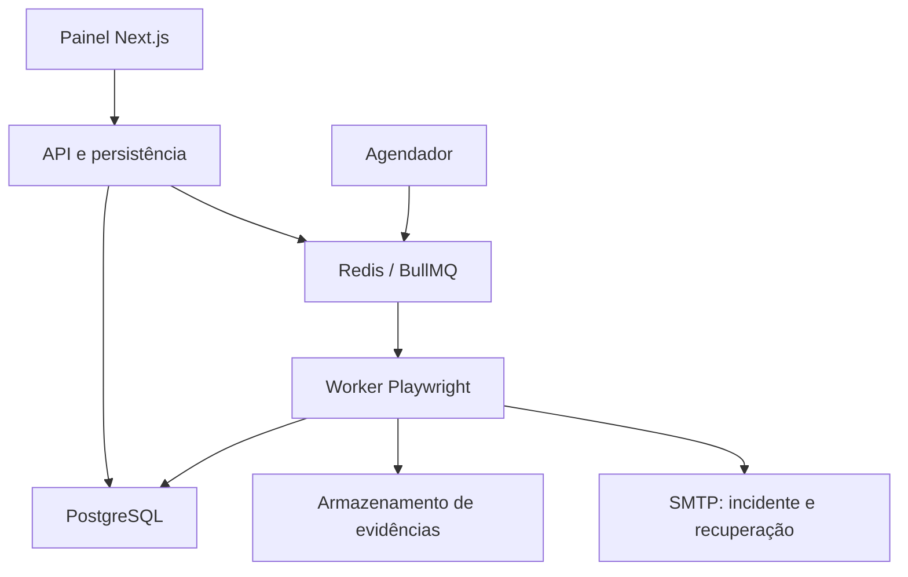

# Farol — plano de execução do MVP

> **Proposta:** detectar quando uma jornada importante de um site deixa de funcionar, mostrar onde falhou e avisar o responsável com evidências.
>
> **Status:** plano inicial · 23/10/2026. Este documento define o alvo do MVP; não representa funcionalidades já implementadas.

## 1. Usuário e problema

O primeiro usuário é um desenvolvedor ou pequena equipe que mantém um site público. O monitor de disponibilidade tradicional diz que a página responde; o Farol deve dizer se uma ação essencial ainda funciona, por exemplo: abrir a página inicial, clicar em “Contato” e ver o formulário.

**Resultado esperado:** cadastrar um site e uma jornada em menos de dez minutos; executar a jornada manualmente e em intervalos; identificar a etapa com erro; consultar captura de tela e histórico; receber e-mail quando a falha for confirmada e quando houver recuperação.

## 2. Limites do primeiro lançamento

### Incluído

- Uma conta administradora por instalação, com sessão protegida.
- Cadastro de site (nome, URL base pública), com uma ou mais jornadas.
- Editor simples para uma sequência de etapas declarativas: abrir caminho, clicar em elemento, preencher campo, verificar texto visível ou URL. Identificação de elementos por role, label ou texto; seletor CSS como opção avançada.
- Teste da jornada sob demanda; agendamento em intervalos fixos de 15 ou 60 minutos.
- Execução isolada no Chromium via Playwright, com limite de tempo por etapa e por jornada.
- Registro de início, fim, duração, etapa que falhou e erro legível. Captura de tela em falha; trace para diagnóstico quando viável.
- Página de visão geral com estados **saudável**, **falhando**, **ainda sem execução**; detalhe da jornada com histórico e evidências.
- Confirmação de incidente após duas falhas consecutivas; um e-mail de abertura e um de recuperação, sem repetir o alerta em cada execução.
- Uma aplicação de demonstração com jornada “saudável” e versão propositalmente quebrada.
- Docker Compose para desenvolvimento e execução própria, `.env.example`, migrações, dados de demonstração e CI.

### Fora do MVP

Gravação visual de testes, geração de jornadas por IA, testes de performance/carga, vídeo de todas as execuções, alertas por WhatsApp/SMS/Slack, cobrança, múltiplas organizações, app móvel, marketplace e execução de código JavaScript fornecido pelo usuário. Login e checkout em sites monitorados ficam para uma fase posterior por exigirem gestão segura de credenciais e ações que podem produzir efeitos reais.

**Regra de segurança:** o worker não deve navegar para endereços locais, privados, loopback ou metadados de nuvem, inclusive após redirecionamento e resolução DNS. Imponha domínio permitido, tamanho máximo dos artefatos, limite de passos, concorrência e duração. Se isso não estiver validado, não exponha cadastro de URLs externas na internet. A conta de administração controla a instância; os sites monitorados no MVP devem ser de propriedade do operador.

## 3. Arquitetura proposta

- **TypeScript** no projeto; **Next.js** para painel e API; **PostgreSQL + Prisma** para dados.
- **Redis + BullMQ** para fila, agendamento e limitação de concorrência. Usar Job Schedulers da versão escolhida, conferindo a documentação antes de implementar.
- **Playwright** num processo/contêiner separado, com Chromium. Capturas somente na falha e trace conforme necessidade; guardar referências no banco e bytes em armazenamento de objetos (MinIO local; S3 compatível em produção).
- **SMTP** configurável para alertas; um adaptador permite trocar o provedor depois.
- Inngest **não é requisito**: Farol é o produto de monitoramento; a fila é um detalhe interno. Não manter Inngest e BullMQ simultaneamente no MVP.
- O agendador cria execuções e o worker grava resultados de forma idempotente. A transição para incidente só ocorre após duas falhas consecutivas; sucesso encerra o incidente. O envio de e-mail tem chave idempotente por incidente/tipo.

**Modelo de dados mínimo:** `User`, `Site`, `Journey`, `JourneyStep`, `Run`, `RunStep`, `Artifact`, `Incident`, `NotificationDelivery`. Guardar o snapshot da definição usada em cada `Run` para que o histórico permaneça inteligível após edições.

**Estrutura inicial sugerida:** `apps/web`, `apps/worker`, `apps/demo-site`, `packages/db`, `packages/shared`, `docs`. Monorepo com workspace npm/pnpm, sem criar microsserviços adicionais.

## 4. Entregas em ordem

| Fase | Entrega verificável | Critério de saída |
| --- | --- | --- |
| **0. Fundação** | Identidade visual, README, estrutura do monorepo, Compose, esquema inicial, lint/typecheck/testes/CI | Outra pessoa inicia com o guia e acessa o painel/demo localmente. |
| **1. Jornada executável** | Editor de passos, validação e execução manual no worker | A jornada da demo passa; ao quebrar o botão, falha na etapa correta e mostra screenshot/erro. |
| **2. Histórico e painel** | Persistência, listagem, detalhe da execução, estados e artefatos | Recarregar o painel preserva os resultados; cada execução mostra qual definição foi usada. |
| **3. Agendamento e alertas** | Fila, intervalos, incidente confirmado, abertura/recuperação por e-mail | Duas falhas consecutivas geram um alerta; novas falhas não duplicam; sucesso envia recuperação. |
| **4. Endurecimento e beta** | Segurança de URLs, limites, autenticação, documentação de deploy, retenção e testes ponta a ponta | Instalação limpa reproduz a demonstração; CI passa e os critérios abaixo são atendidos. |

**Ordem de implementação:** faça primeiro uma execução manual real e observe uma falha com evidência. Só então construa agendamento, e-mail e polimento do painel. A estimativa para uma pessoa é **4–6 semanas de trabalho focado**, sujeita à familiaridade com o stack e ao ambiente de deploy.

### Backlog inicial, em fatias pequenas

1. Definir tokens visuais (cores, tipografia, estados e componentes de status) e desenhar telas: visão geral, criar jornada, detalhe da execução.
2. Criar monorepo, Compose (web, worker, PostgreSQL, Redis, MinIO, demo), Prisma e health checks.
3. Implementar a demo e o runner de uma jornada fixa com tempos limite e uma captura em falha.
4. Persistir `Run` e `RunStep`; mostrar resultado da execução manual no painel.
5. Adicionar CRUD de site/jornada e validação dos passos declarativos.
6. Conectar agendador e fila com limite de concorrência e política de não sobrepor a mesma jornada.
7. Implementar máquina de estados de incidente e envio SMTP idempotente.
8. Completar isolamento de URL/redirecionamentos, autenticação, retenção de artefatos, testes e documentação de operação.

## 5. Identidade e experiência

**Nome:** Farol. **Mensagem:** “Saiba quando seu site para de funcionar para quem o usa.” Interface de observabilidade clara, sem excesso de gráficos: fundo azul-marinho/grafite, superfícies claras ou escuras com contraste adequado, acento ciano para ações, verde para saudável, âmbar para atenção e vermelho para falha. O ícone deve remeter ao feixe de um farol e ser legível em 16 px. Status nunca depende só de cor; sempre incluir texto/ícone. Dashboard inicial: cartão de cada site, última verificação, jornada afetada e botão “Ver evidência”.

## 6. Testes e definição de pronto

- **Unidade:** validação da DSL, transições de incidente, deduplicação de alertas e restrição de URLs.
- **Integração:** persistência, agendamento/worker, reprocessamento idempotente e armazenamento.
- **Ponta a ponta:** demo saudável → execução bem-sucedida; demo quebrada → falha com screenshot; segunda falha → incidente; recuperação → encerramento e notificação.
- **CI:** lint, typecheck, testes unitários/integração pertinentes, build e smoke test do runner.
- **Operação:** sem chaves no Git; `.env.example`; migrações reproduzíveis; logs estruturados com IDs de execução; política de retenção de 30 dias para artefatos e limite por execução.

O MVP está pronto quando um desenvolvedor consegue instalar seguindo o README, cadastrar uma jornada de seu site, executá-la, deixá-la agendada, observar uma falha reproduzível com evidência, receber **um** alerta confirmado e um aviso de recuperação — com CI verde e documentação suficiente para operar a instalação.

## 7. Documentação a manter

- `README.md`: proposta, GIF/imagens da demo, início rápido, arquitetura resumida e limitações.
- `docs/architecture.md`: componentes, modelo de dados, fluxo de execução e decisões técnicas.
- `docs/journeys.md`: passos suportados, exemplo e boas práticas de seletores.
- `docs/deployment.md`: variáveis, migração, backup, SMTP, armazenamento e limites.
- `docs/security.md`: política de URLs, isolamento, credenciais e divulgação de falhas.
- `CONTRIBUTING.md`: setup, convenções e comandos de verificação.

### Referências de implementação

- [Playwright — testes e evidências](https://playwright.dev/docs/best-practices)
- [BullMQ — Job Schedulers](https://docs.bullmq.io/guide/job-schedulers/)
